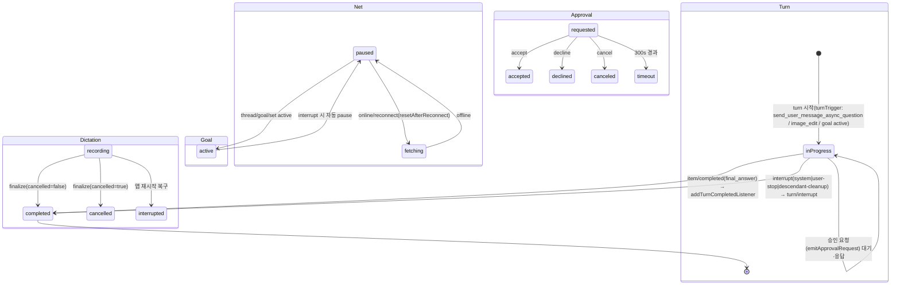

# OpenAI Codex 데스크톱 앱(v26.917.71314) 상태 머신 추출 — 정적 분석 결과

**대상 번들**: `webview/assets/app-initial-51da50e6c6e3.js`(렌더러 코어/스토어), `app-shared-7b9edc1bfb7f.js`(설정 스키마 레지스트리), `app-primary-d66705000d76.js`(컴포저/화면), `.vite/build/main-C-Mhak1n.js`(Electron 메인 + 스레드 매니저 사본). 행 번호는 원본 파일 기준.
**방법**: minified 단일 라인이므로 grep으로 라인 위치를 찾고 `read :raw`로 라인 전문을 추출해 근거화. **실측** = 문자열/코드에서 직접 확인, **[추정]** = 문맥 해석. 작업 지시에 포함된 TUI(codex-rs) 토큰(`queued`, `in_progress`, `awaiting`, `request_approval`, `exec_command`, `apply_patch` 승인 등)은 **데스크톱 번들에서 미검출**이었으며, 앱은 자체 camelCase 상태 체계를 사용한다(§6 참조).

---

## 1. 태스크 · 턴 · 세션 상태

### 1.1 턴(Turn) 상태 — `inProgress` / `completed` (2값 실측)
턴 상태는 스레드 스토어의 `subscribe({type:'turn', field:'status'})`로 관찰된다.

| 상태 | 근거 |
|---|---|
| `inProgress` | `app-primary-d66705000d76.js:72` — `if(c.get(mu,h)!==e.turnId||c.get(Af,h)!=='inProgress')return` (steer 응답 후 턴 일치 + 진행 중 가드); `app-initial:1773` — `y.status==='inProgress'` |
| `completed` | `app-initial:1793` — `subscribe({type:'turn',...field:'status',listener:n=>{if(!l||n!=='completed')return;...}})` 및 `addTurnCompletedListener(e=>{e.status==='completed'&&...})` |
| placeholder 턴(진행 중 빈 턴) | `main-C-Mhak1n.js:408` — `t.turnId==null&&t.status==='inProgress'&&t.items.length===0&&x_(e,t)` (합성 아이템 제거 시 placeholder 턴도 제거) |

**턴 객체 필드**(main:495, `CSe` — goal 재실행용 합성 턴): `{turnId, turnStartedAtMs, durationMs, firstTurnWorkItemStartedAtMs, finalAssistantStartedAtMs, status:'completed', error:null, diff:null, items:[], params:{approvalPolicy, approvalsReviewer, sandboxPolicy, model, effort:'minimal', summary:'none', ...}}` — 즉 턴은 **상태 문자열 외에 `error`·`diff`를 별도 필드**로 가진다. `firstTurnWorkItemStartedAtMs`는 최초 작업 아이템(fileChange 등) 도착 시 설정된다(main:407 `e.firstTurnWorkItemStartedAtMs=e.firstTurnWorkItemStartedAtMs??this.now()`).

**[추정]** `failed`/`interrupted`는 턴 상태 enum 값이 아니라, `error` 필드 + 인터럽트 플로우(아래)로 표현된다. 근거: `emitTurnFailed|turn/failed|turnFailed` 문자열이 main 전체 및 app-initial 4MB 창에서 미검출.

### 1.2 인터럽트(중단) 머신 — 모드 3종
`main-C-Mhak1n.js:495`(매니저, artifact://64 참조):
- `interruptConversation(e, t='system', expectedTurnId?)` — **모드**: `system` | `user-stop` | `descendant-cleanup`.
- 전이: ① follower면 IPC `thread-follower-interrupt-turn {conversationId, mode, expectedTurnId}` 시도 → ② 실패 시 오류 문자열이 `timeout|request-version-mismatch|no-client-found` 중 하나면 owner 부재로 판단, `markConversationNeedsResumeForUnavailableOwner` 후 로컬 인터럽트 폴백 → ③ 로컬: `emitTurnInterruptStarted` → (threadGoal active면) `thread/goal/set {status:'paused'}` → `turn/interrupt {threadId, turnId}` 요청. `backgroundCleanup`은 `t==='user-stop'&&expectedTurnId==null`일 때 활성. `user-stop`이면 서브에이전트 자손까지 백그라운드 인터럽트.
- goal 재개: `thread/goal/set {status:'active'}` 시 `threadGoalResumeConfirmation` 리셋(main:495 `SSe`).

### 1.3 스티어링 / 후속 입력 큐 — `queue | steer | interrupt`
- **설정 enum**(사용자 선택 가능): `app-shared-7b9edc1bfb7f.js:277` — `followUpQueueMode: {key:'followUpQueueMode', schema:K(['queue','steer','interrupt']), description:"How follow-up prompts behave while a turn is running"}` (VS Code 기본 `queue`, 전송 시 Cmd/Ctrl+Shift+Enter로 반전).
- 실제 스티어 처리: `app-initial:1691`/`main:495` — 스티어 메시지가 `steeringUserMessage` 아이템으로 현재 턴에 주입(`targetTurnId:n.turnId, turnStartedAtMs` 갱신)되고 `emitTurnSteered(n)` 발생. 요청 경로: `app-primary:72` — `xue({...turnTrigger:'send_user_message_async_question',...}, 'steer')`.
- **turnTrigger 값(실측)**: `send_user_message_async_question`(app-primary:72), `image_edit`(app-primary:119).

### 1.4 세션/스레드 수명 상태
- **시작 페이즈**(app-shared:277): `bootstrap → host_ready → window_created → renderer_ready → first_content_visible → background_ready` (`hasReached/reach/whenReached` 단조 진행 머신).
- **스레드 소스**(main:495-506 영역, `cW()`): `cli|vscode|exec|appServer|subAgent|subAgentReview|subAgentCompact|subAgentThreadSpawn|subAgentOther|unknown` + 특수 `chatgpt_hidden`, `ambient_suggestions`, `pull_request_fix_automation`. threadSource 실측값: `realtime_voice`(main:495), `pull_request_fix_automation`(main:495 fork 검증).
- **프리웜 터미널 스레드**: TTL 285초(`DSe=285`), `isFresh()`/`consumePrewarmedThread` — 설정 불일치 시 폐기(main:495 영역).
- **읽음 상태**: `hasUnreadTurn`, `unreadMessageCount`, `savedReadStatePending` — `completeTurn()`에서 미읽 카운트 정산(main:495 영역 `ESe`).
- **재개 상태**: `resumeState === 'needs_resume'` (main:495 영역, `resumeForFileApproval`) — owner 부재/파일 승인 시 재개 필요 마킹. 다른 resumeState 값은 미검출.
- **워크트리**: 출력 버퍼 분기 `n==='setting-up'?setupOutputText:worktreeOutputText` (main:1093) — `setting-up` → 활성 2상. 생성 요청 `operationSource:'worktree_pending_create'`(main:1092). 정리 사유 enum(main:1093 `QQe`): `settings-delete-targeted→worktree_settings_delete`, `archive-cleanup`, `startup-cleanup`, `new-branch-cleanup`, ...
- **받아쓰기 녹음 상태기(전이 완결)**(main:1095): `status: z.enum(['recording','completed','cancelled','interrupted'])`, `surface: z.enum(['composer','global'])`. 전이: 청크 append → `recording` / `finalize({cancelled})` → `cancelled`|`completed` / **앱 재시작 복구 시 `recording` → `interrupted`** / `recording` 상태 삭제 시도 → 에러("Cannot delete an active dictation recording"). 보관: 최근 20개.
- **스레드 골**(반복 작업): `thread/goal/set {status:'active'|'paused'}` (main:495 `xSe`/`SSe`), 골 활성 + system 인터럽트 시 자동 pause.

### 1.5 ChatGPT 대화 임포트 턴 상태
`app-initial:2512`(`p$n`): 임포트된 턴은 `{id, status, error, startedAt, completedAt, durationMs, items}`로 정규화되며 합성 시 `status:'completed', error:null`. 첨부파일 상태: `ready | uploading | error`(같은 라인 `Q5n/t7n`). 브라우저 폼필 액션 결과 enum(같은 라인 `q$n`): `submitted|declined|cancelled|unavailable|expired|origin_changed|page_changed|locator_invalid|submission_failed`.

---

## 2. 승인(Approval) 상태 머신

### 2.1 권한 프로파일 호환 매트릭스 (자동화 시작 조건)
`main-C-Mhak1n.js:90`(`fs`) — 자동화(스케줄)용 권한 선택:
```js
r=[e.approvalsReviewer,...allowedApprovalsReviewers]; i=[e.approvalPolicy,...allowedApprovalPolicies];
a=[e.sandboxPolicy, default]; for o of a: if(o.type!=='dangerFullAccess' && allowedPermissionProfiles==null)
  for reviewer of r: for policy of i: if((policy!=='never'||e.approvalPolicy==='never') && compatible(...))
    return {...e, activePermissionProfile:null, sandboxPolicy:o, approvalPolicy:policy, approvalsReviewer:reviewer};
throw Error('No compatible automation permissions satisf…')
```
- 축 3개: `approvalPolicy`(값 `never` 실측), `approvalsReviewer`, `sandboxPolicy.type`(`dangerFullAccess`, `workspaceWrite` 실측 — main:90, main:495 영역 `NSe`의 `sandbox.type==='workspaceWrite'|'dangerFullAccess'`). `activePermissionProfile:null`로 강등하는 폴백 탐색이 전이의 본질.
- 턴 파라미터로 `approvalPolicy/approvalsReviewer/sandboxPolicy`가 매 턴 전달됨(main:495 `CSe`).

### 2.2 승인 요청/응답 API (매니저 표면)
`main-C-Mhak1n.js:495` 영역(artifact://64) — 서버 요청 수신(`onRequest`) 시 `emitApprovalRequest`/`emitUserInputRequest`로 이벤트 발행, 응답은 전용 메서드:
- `replyWithCommandExecutionApprovalDecision(conv, requestId, decision)` — **exec(커맨드 실행) 승인**
- `replyWithFileChangeApprovalDecision(conv, requestId, decision)` — **파일 변경(patch) 승인**
- `replyWithPermissionsRequestApprovalResponse` — 권한 요청 승인
- `replyWithUserInputResponse` / `replyWithOptionPickerResponse` — 에이전트의 사용자 질문/선택지
- `replyWithMcpServerElicitationResponse` / `beginUserVerification` / `replyWithDynamicToolResponse`
- 승인 완료 이벤트: `emitApprovalResolved({conversationId, requestId})`.
- 요청 채널은 서버→앱 **request**(예: `item/tool/call`, elicitation)이며, `resumeNotificationBuffer`/`threadStartedNotificationDeferral`로 턴 시작 지연 중 요청을 버퍼링(main:495 `bC`/`TSe`).

### 2.3 decision 문자열 (computer-use 승인 브리지 — 완결 머신)
`main-C-Mhak1n.js:8`:
- 스키마: `{action: z.enum(['accept','decline','cancel']), _meta:{persist: z.enum(['always','session'])}}`.
- 매핑: `accept→'accepted'`, `decline→'declined'`, `cancel→'canceled'`, 파싱 실패 → `'unknown'`.
- 타임아웃: 300초(`Ure=3e5`) 후 `approvalResult:'timeout'` + reject.
- 분석 이벤트: `app-approval-requested` → `app-approval-resolved {approvalResult, approvalPersistence}`; 툴 호출 단위 `terminalStatus: 'completed'|'failed'`.
- 메서드명: `requestComputerUseApproval`, 요청 ID 접두 `computer-use-approval:`.

### 2.4 기타 승인 표면
- ChatGPT 호스티드 툴 승인 아이템: `chatgpt-tool-approval` 메시지 타입(app-initial:2538).
- 알림 연동 설정(app-shared:277): `notifications.turnMode: ['off','unfocused','always']`("턴 완료 알림 표시 시점"), `notifications.permissionsEnabled`, `notifications.questionsEnabled` — 승인 대기가 알림으로 탈출하는 조건.
- PR 리뷰 이벤트 enum(app-shared:277 `lUe`): **`approved | changes_requested | merged | opened`** (+이벤트 타입 `comment|review|review_comment`, 리뷰 전달 `reviewDelivery: inline|detached`, diff 필터 `branch|last-turn`).
- 브라우저 사용 승인 모드(main:575): `approvalMode / chromeHistoryApprovalMode / iabHistoryApprovalMode / downloadApprovalMode / uploadApprovalMode`(config.toml 기반), 컴퓨터유즈 앱 허용목록 `ComputerUseAppApprovals.json {approvedBundleIdentifiers}`(main:708).
- 외부 채널 훅: codex CLI `notify` 설정에 `[codex-app-tools, 'turn-ended']` 주입(main:8 영역 `iie`).
- **미검출 명시**: `request_approval`, `exec_command`, `apply_patch` 리터럴은 4개 번들 4MB 창에서 없음 → 데스크톱 앱은 TUI식 승인 문자열 대신 §2.2의 commandExecution/fileChange/permissions/elicitation 추상화 사용.

---

## 3. 스트리밍 상태 (토큰/델타 생성)

### 3.1 서버→앱 델타 알림 채널 (main:407 `Rve.handleNotification`)
| 메서드 | 대상 아이템 | 처리 |
|---|---|---|
| `item/agentMessage/delta` | agentMessage.text | 프레임 큐에 적재 후 일괄 append |
| `item/plan/delta` | plan.text | 동일 |
| `item/reasoning/summaryTextDelta` | reasoning.summary[summaryIndex] | 부분 배열 자동 확장 |
| `item/reasoning/summaryPartAdded` | — | 로그만 |
| `item/reasoning/textDelta` | reasoning.content[contentIndex] | 동일 |
| `item/commandExecution/outputDelta` | commandExecution.aggregatedOutput | **50ms 플러시**(main:407 `flushIntervalMs:50`), 상한 도달 시 접두 `[output truncated]` 마커 관리 |
| `item/commandExecution/terminalInteraction` | commandExecution.commandActions | stdin 명령 파싱 → `{type:'unknown',command}` push |
| `item/fileChange/patchUpdated` | fileChange | 아이템 없으면 `status:'inProgress'`로 생성, 있으면 changes 교체. `rebindLatestInProgressPlaceholder:true` |

라이프사이클 알림: `item/started`, `item/completed`(에이전트 메시지 완료 시 미전송 델타 dedup — main:495 `mSe`), `thread/started`, `thread/realtime/started|closed`, `turn/started`(app-initial:1795 `addNotificationCallback('turn/started')`), 계정 이벤트 `account/updated|account/login/completed`.

### 3.2 아이템 타입/페이즈
- 아이템 타입 실측: `userMessage`, `steeringUserMessage`, `agentMessage`, `plan`, `reasoning`, `commandExecution`, `fileChange`, `contextCompaction`(합성, `{id:'pending-manual-context-compaction', completed:false, source:'manual'|'automatic'}` — main:408 `Bve`), `handoff_request`(음성 위임), `subAgentActivity {kind:'started'}`, `collabAgentToolCall {tool:'spawnAgent'}`, `hookPrompt`(main:407-408, 494-495).
- agentMessage 페이즈: `phase:'final_answer'|null`, `delivery:'async'`(비동기 배치) — 스트리밍 텍스트는 `turn.status==='inProgress'` + 최종 어시스턴트 매칭 시에만 인라인 병합(app-initial:1773).
- 툴 결과 3상: `{type:'success'|'error', kind:'tool'}` + 파싱 실패 `unknown`(app-initial:1754).
- 컨텍스트 컴팩션: `source` 소비 순서 `manual → automatic` 폴백(main:408 `consumeSource`).

### 3.3 스트리밍 표현/UI 상태
- **`conversationDetailMode`**(app-shared:277): `STEPS_PROSE | STEPS_COMMANDS | STEPS_EXECUTION` — "턴 디테일 표시 수준" 3단이 스트리밍 UX의 정식 enum.
- ChatGPT 경로 스트리밍 플래그: `isStreaming`, `isActiveTurnCancelled`(app-initial:2527 `Qir`), `streamRe…`(스트리밍 재연결 계열, app-initial:2538 `Zor` 시그니처에 `status:i, streamRe...`).
- 토큰 예산 힌트: `token-budget-thread:` 히스토리 노트 키 + `features.token_budget {enabled, use_history_notes_extension}`(main:421).
- 첨부 업로드: `ready|uploading|error`(app-initial:2512).
- 멀티윈도우: `stream role owner|follower`, `getStreamingConversations`, `broadcastConversationSnapshot`, `registerWindowActivity` → 소유 윈도우만 렌더링/전파(main:495 영역, artifact://64).

---

## 4. 연결 상태

### 4.1 전송 계층 (main:570)
`AppServerTransportSshWebsocket`: `kind='websocket'`, **`supportsReconnect(){return true}`**, `hasConnected` 플래그, `onAppServerInitializationFailed(){this.hasConnected=false}`. 즉 재접속은 문자열 상태가 아니라 `supportsReconnect`/`hasConnected` 부울 + 재시도 조합. SSH 원격 명령 타임아웃 문구: "SSH: codex --version check timed out"(main:571).

### 4.2 쿼리/네트워크 계층 (main:8, react-query 사본)
- `status: pending|success|error` × `fetchStatus: idle|fetching|paused` — 오프라인(`networkMode` 기본 `online`)일 때 `paused`로 진입, `online` 이벤트에 `shouldFetchOnReconnect` 재개.
- window `online`/`offline` 리스너(`_n` onlineManager), 재시도 기본 3회 + 지수 백오프 `min(1000*2^n, 30000)`, 포커스 `visibilitychange`.
- `offline` 리터럴의 기원은 이 계층(실측). `connecting`/`reconnecting` 상태 문자열은 미검출 — **[추정]** UI의 재접속 표시는 fetchStatus/retry 파생.

### 4.3 재접속 후 정리
`account/updated|account/login/completed` 수신 시 `pagination.resetAfterReconnect()` + `turnStartObservations.clear()`(main:495 영역) — 페이지네이션 상태가 재접속 시 리셋되는 전이.

### 4.4 호스트/원격 연결
- 호스트 연결 레지스트리(main:8 `cee`): `addConnection/removeConnection` → 구독자에게 `{type:'added'|'removed', hostId, connection}` 이벤트. 연결 상태는 **집합 멤버십(connected 여부)** 으로 모델링.
- MCP 전송 공통: `pendingRequests` reject-on-close, `addCloseListener`(main:9 `kn`).
- 원격 제어/SSH: `remoteConnectionsByHostId`, 리프레시 제너레이션 카운터(main:1293), 등록 오류 enum(app-shared:277): `remote_control_device_key_tpm_unavailable|_tpm_configuration|_store_unavailable|_unusable`, 계정 불일치 `remote_control_enrollment_account_mismatch`.
- follower 폴백 오류 분류(main:495): `timeout`, `request-version-mismatch`, `no-client-found` → owner 부재 판정 후 로컬 폴백.

---

## 5. 요약 전이 다이어그램



---

## 6. 실측 vs 추정 / 미검출 목록

**실측(문자열/코드 직접 확인)**: `inProgress`, `completed`, `setting-up`, `recording/completed/cancelled/interrupted`, `composer/global`, `queue/steer/interrupt`, `active/paused`(goal), `accept/decline/cancel`→`accepted/declined/canceled`(+`unknown`/`timeout`), `always/session`(persist), `approved/changes_requested/merged/opened`, `submitted/declined/cancelled/unavailable/expired/origin_changed/page_changed/locator_invalid/submission_failed`, `STEPS_PROSE/STEPS_COMMANDS/STEPS_EXECUTION`, `off/unfocused/always`(turnMode), `ready/uploading/error`(첨부), `owner/follower`, `pending/success/error`×`idle/fetching/paused`, `needs_resume`, `system/user-stop/descendant-cleanup`, 스트리밍 알림 8종, 시작 페이즈 6종, 스레드 소스 10종+3 특수.

**[추정]**: `failed`/`interrupted`가 턴 enum에 없고 error 필드+인터럽트로 처리된다는 해석; `connecting/reconnecting` 부재 시 UI가 fetchStatus 파생 표시를 쓴다는 해석; app-primary 119-121 부근의 `queued` 리터럴이 전송 큐 문맥이라는 해석(리터럴 존재는 실측, 문맥은 윈도우 잘림으로 미확인).

**미검출(데스크톱 번들 기준)**: `queued`(상태 enum으로서), `in_progress`, `awaiting*`, `reviewing`(상태로서 — `reviewing`은 시스템 프롬프트 산문에만 존재, app-initial:2518), `request_approval`, `exec_command`, `apply_patch`, `emitTurnFailed/turn/failed`, `connecting`/`reconnecting` 리터럴. → EXPERIENCE.md 작성 시 TUI 상태 이름을 그대로 이식하지 말고 위 데스크톱 자체 어휘를 사용할 것.

**ko-KR.json 참고**: 단일 라인 minified 카탈로그로 라벨 전문 추출은 불가(grep 윈도우 한계). 키 확인됨: `appHeader.installUpdate.confirmCancel/confirmInstall/confirmSubtitle("…활성 로컬 세션이 중단됩니다")`, `browserSidebar.contextMenu.*` 등 — 네이티브 메뉴 라벨 출처로만 활용 권장.