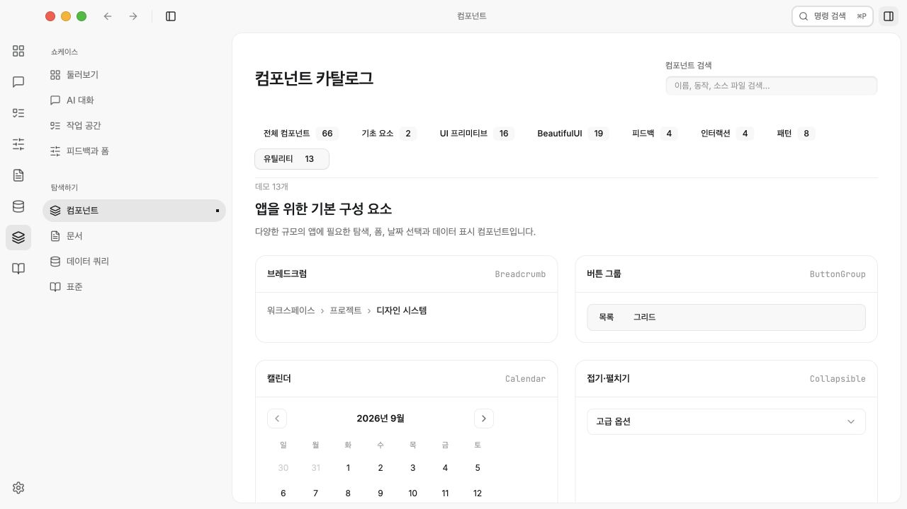

# Catalog adoption verification — 2026-09-27

## Scope

Added 8 pattern families and 13 utility families to `@garden/ui`, with English/Korean playground examples. The catalog now contains 66 demos (45 existing, 21 new). See [the adoption decision](../decisions/ui-catalog-adoption-2026-09-27.md) for source provenance, retained components, and exclusions. No upstream code or assets were copied, and no dependencies were added.

## Automated checks

- `bun run --filter @garden/ui build`: passed.
- `bun run --filter @garden/playground build`: passed, including the final calendar heading style correction. Vite reports its large-chunk warning for the playground bundle.
- `bun test packages/ui/tests`: 8 passed, 0 failed, 35 assertions. Covers stable immutable sorting, mixed values and null handling, calendar date validation/arithmetic and month bounds.
- New English/Korean locale key structures match.
- `git diff --check`: passed for tracked changes.
- Two source review passes completed; identified focus, overflow, disabled-state and composition-input issues were fixed.

## Running application

Verified the production preview at port 5187 with the in-app browser. Both reference catalogs were inspected separately. All 21 new demo families rendered and their primary interaction paths were exercised:

- Breadcrumb anchors, button-group selection, native disclosure, form validation and error clearing, OTP input editing, pagination boundary controls, native slider keyboard adjustment, and semantic table output.
- Calendar adjacent-month selection and arrow navigation; date-picker named dialog, selection, dismissal and clearing.
- Combobox filtering, keyboard selection, empty results and Escape restoration.
- Data-table ascending/descending numeric sorting.
- Sheet focus containment, Escape dismissal and return to its trigger.
- Avatar overflow, checklist completion, timeline navigation, dock arrow navigation/activation, and text-reveal replay.
- Command copy reported success and clipboard text matched the displayed command. Terminal sample completed without executing a process. Animated link navigated to its anchor.
- Catalog search narrowed to one timeline demo and showed the reset state for no matches.

English dark and Korean light views were inspected. At 390 × 844, the document width remained 390 pixels and utility cards had no horizontal overflow. The temporary viewport override was reset. Browser warning/error logs were empty during these checks.

## Limits and existing workspace state

The token generator check detects preexisting drift in `packages/ui/src/styles/garden.css`: regeneration would restore legacy records rules already moved by the ongoing workspace migration. That unrelated file was preserved rather than overwritten. The repository-wide/native checks were not run.

The development server showed a blank root during this session, so runtime verification used the independently built production preview. Real operating-system IME composition, screen-reader announcements, reduced-motion emulation and every popup placement at every viewport were not runtime-tested; their implementation paths were source-reviewed. The OTP field's value is redacted by browser tooling, so its normalization is not claimed as an independently observed browser value assertion.
