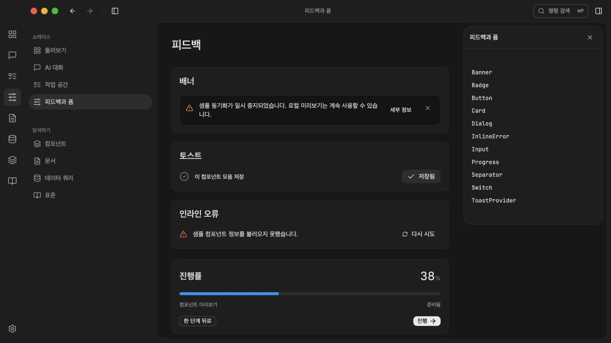
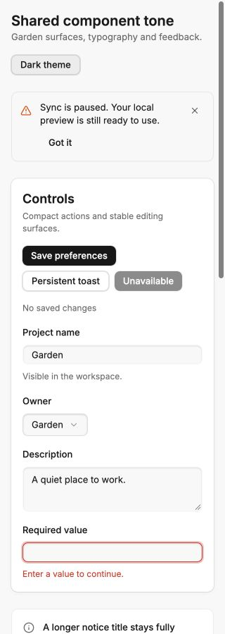
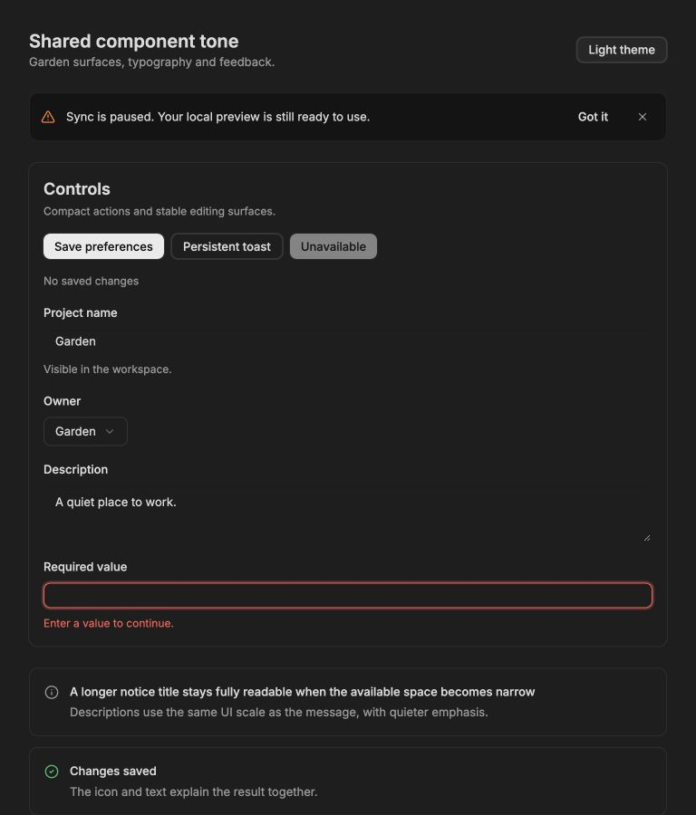

# Shared component tone verification

Date: 2026-09-27. Scope: public `@garden/ui` primitives, token generation,
typography class merging, and the existing feedback showcase. The ongoing
framework migration and preserved reference specimens were retained.

## Changes

- Made typography, radius and motion generation read the canonical token JSON.
  Added the existing 10px card role to that source and restored the canonical
  12.5px `lg` radius. Garden declarations follow the vendored theme and remain
  available to plain CSS. Compatibility aliases remain supported.
- Registered Garden type sizes with `tailwind-merge`. Previously
  `cn("text-ui", "text-ink")` discarded the size and could render at the browser's
  16px default. Regression coverage verifies independent size/color precedence,
  caller overrides and state variants.
- Standardized fields/actions at control radius 8px, compact controls at chip
  radius 6px, cards/anchored popups/feedback at card radius 10px, and dialogs at
  xl radius 15px. Progressive superellipse styling excludes circular controls.
- Standardized UI copy at 13px, compact copy at 12px, ordinary card/dialog content
  at 14px, and card/dialog headings at 18px with their token line height.
- Reworked banner, alert, inline error, toast and empty-state hierarchy. Neutral
  surfaces and foreground copy carry status icons; local actions use the shared
  button. Alert titles wrap. Removed showcase rules overriding banner geometry.
- Replaced remaining literal type sizes/radii in shared shell, calendar,
  checklist and revision-timeline styles with semantic variables. Corrected
  destructive-action foreground contrast in dark mode.

## Running browser observations

The standalone scene is
[`component-tone.html`](../../apps/playground/tests/component-tone.html), served
at `http://127.0.0.1:5173/tests/component-tone.html`. It is a manual interaction
fixture rather than an automated E2E suite. The integrated playground was also
checked in English and Korean.

| Check | Observed result |
| --- | --- |
| Light/dark at 320, 375, 414 and 768 CSS px | Document scroll width equals viewport width in all eight cases |
| Named typography | Alert body/title 13px, line height 18.85px; input/textarea/button 13px; card/dialog title 18px |
| Curvature | Field/action 8px, card/alert/banner/toast/select/popover 10px, dialog 15px |
| Narrow select | ArrowDown + Enter selects Team and closes the list |
| Narrow dialog | 288px width within a 320px viewport, 16px side insets; Escape returns focus to its trigger |
| Tabs | ArrowRight selects Details and reveals its panel |
| Retry | Button disables while pending and transitions to Connection restored |
| Save/Undo | Save changes the status; Undo restores the prior state |
| Toast focus | A focused toast remains beyond five seconds; Undo still works |
| Korean scene | Localized banner, save notification and recovery controls remain readable |

Foreground contrast was calculated from the actual semantic token pairs.
Primary text on neutral surfaces ranges from 12.08:1 to 17.08:1; secondary text
ranges from 5.20:1 to 6.41:1. Destructive button text measures 4.57:1 in light and
6.83:1 in dark. These figures cover the changed feedback/action text pairs, not
a claim of whole-catalog accessibility conformance.

## Commands

- `node scripts/build-tokens.mjs --check` — current.
- `bun test packages/ui/tests` — 11 passed, 0 failed, 58 assertions.
- `bun run --filter @garden/ui build` — passed.
- `bun run --filter @garden/playground build` — passed.
- Explicit TypeScript check of `tests/component-tone.tsx` using a temporary
  playground config — passed; config removed afterward.
- `git diff --check` — passed.
- Independent source review — no material findings in the scoped changes.

Vite reports its bundle-size warning for the playground. Native packaging and
deployment are outside this UI change's verification scope. Initial development
HMR invalidations required a full page refresh; final checks used the settled
implementation.

## Screenshots

