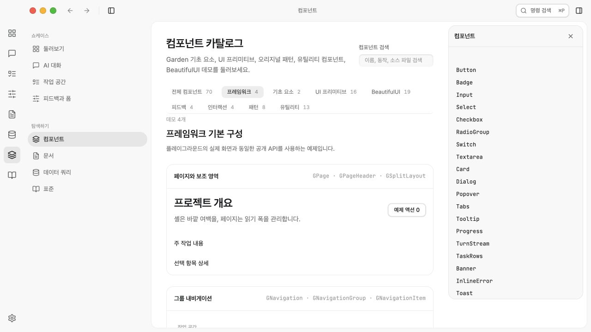

# UI standardization verification

Date: 2026-09-27. Target: the running playground at `http://127.0.0.1:5173`.
Scope: public page/navigation/composer/selection APIs, scene migrations,
native tables, canonical command palette, feedback labels and timer behavior.

## Automated checks

| Check | Result |
| --- | --- |
| `bun run --filter @garden/ui build` | Pass |
| `bun run --filter @garden/playground build` | TypeScript and Vite pass |
| `bun test packages/ui/tests` | 8 tests, 35 assertions pass |
| `bun test cli/tests` | 3 tests, 23 assertions pass |
| `node scripts/build-tokens.mjs --check` | Pass |
| `node cli/garden.mjs doctor` | Healthy |
| English/Korean nested locale key parity | All six catalog pairs pass |
| `git diff --check` | Pass |

Vite reports a non-blocking chunk-size advisory above 500 kB. The package unit
suite covers sorting/calendar logic; interaction evidence below comes from the
running app, not from source-string assertions.

The first token check found that shared Records table rules had been removed
from generated CSS without teaching the generator about their standalone owner.
The generator now omits exact whole-line duplicates found in `table.css`, while
preserving the vendored file. Regenerated CSS matches the pre-task stylesheet
byte-for-byte; both token check and doctor subsequently passed.

## Observed interactions

- Composer: an empty draft disables send; Shift+Enter inserts a newline; Enter
  submits trimmed text and the scene clears its draft. The framework example's
  pending toggle disables both entry and send, retains the draft, then permits
  sending after resuming. Composition and keyCode-229 submission guards were
  inspected in source; native OS IME confirmation was not exercised.
- Segmented control: native ArrowRight moves selection; the framework example
  skips its disabled middle option. Filter counts are included in accessible
  names. All control instances retain distinct IDs.
- Workspace table: filtering to review leaves one data row; completing that
  task produces a valid empty row with Show all tasks. Resetting filters and
  adding a task yields five data rows. Selection updates task details. All four
  `<td>` columns compute to `display: table-cell`; owner/progress layout belongs
  to their inner wrappers.
- Command palette: the catalog example renders the canonical implementation;
  disabled-only results have no active descendant and cannot execute. With the
  catalog mounted, the shell shortcut opens exactly one palette. Tab cycles
  between search and close; Escape restores focus; Enter executes the selected
  command and closes the overlay.
- Palette regression: open `/tests/framework.html`, choose the second enabled
  command, wait while the parent recreates the inline registry, then press Enter.
  Observed parent revision advance from 0 to 39 with the same active option;
  result was `Second`, with no remaining dialog. The fixture is retained for
  reproducing this previously found reset bug.
- Feedback: Save produces a localized toast; Undo restores the save state.
  Retry first displays pending and then clears the inline failure. Dismissing
  the decision dialog returns focus to its Details trigger.
- Toast timing: while its close button was focused, a toast remained after
  5.5 seconds. Moving focus to the sample name field resumed expiration; the
  toast was gone after another 5.5 seconds. Console error/warning log was empty.
- Layout: at 390×844 the viewport had no horizontal overflow, headers retained
  actions, and page-local supporting content stacked into one 304px column.
  Wide table content scrolled within its table region. Desktop workspace with
  its shell context panel closed measured 555px main + 300px support columns.
- Korean/light and English/dark views were exercised. Settings still exposes
  associated switch/select labels and responsive section tabs. The framework
  category and search expose the new APIs and counts correctly.

## Review and artifacts

Independent review identified two integration defects: palette selection reset
on parent render, and flex/grid styles remaining directly on migrated table
cells. Both were fixed and re-reviewed with no remaining material findings.

Native Tauri window behavior and native Safari/WKWebView IME input were not
tested in this pass. No storage, document format or host integration behavior
was changed.
